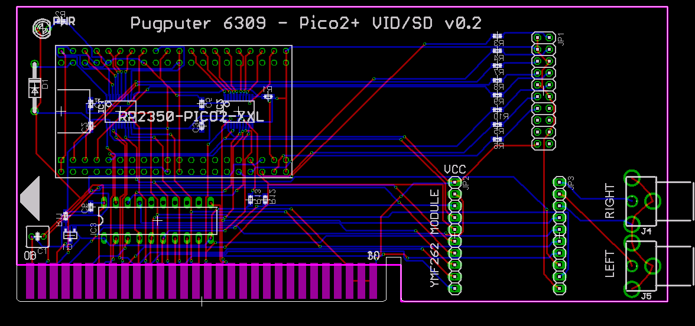
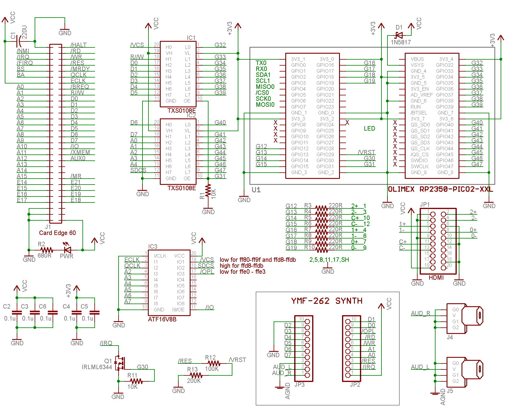

## RP2350B (Raspberry Pi Pico 2) Video Card

This is the video card implemented by the emulator, and it's hugely more performant than the V9958 predecessor,
and I've transplanted the OPL3 module to this card for sweet tunes, even though the RP2350B can probably
handle audio synth/output (over DVI) too. This card is based on an Olimex RP2350-PICO2-XXL, and a cheap 
HDMI breakout board off Amazon. (Going to need to get a real part 
number on that part eventually.) Basically, pin 0, at the top-left is GND, and after that its HDMI pins 1 
through 19.

Since this olimex module has an SD card slot on it, and USB, I may as well try to shoehorn SD card functions,
as well as keyboard, mouse, gamepad, connections. (The firmware does the SD card; USB keyboard and
mouse aren't in it yet.) No room for a 4-port hub and usb connectors at the moment..
maybe if I find some a wacky-sideways HDMI connector? I agree it feels like cheating to use a modern MCU 
to provide so many functions for the Pugputer 6309. Maybe someday there will be a discrete TTL logic version.

For a writeup on the current capabilities of this card, see [Pugputer6309_Emulator - Video card readme](https://github.com/caiannello/Pugputer6309_Emulator/tree/main/vidcard)

## What's where

| | |
|---|---|
| `pico2_video.sch`, `.brd`, `gerbers/` | the card (EAGLE 4.16r2) |
| `VIDCARD.PLD` | the GAL's equations (IC3, ATF16V8B): compile with WinCUPL, burn the `.jed` |
| [`Software/RP2350/video_misc`](../../Software/RP2350/video_misc) | the RP2350's firmware, and `vidcard.uf2` ready to flash |
| [`Software/6309/bios`](../../Software/6309/bios) | the CPU card's BIOS, which finds this card at boot and boots DOS from its SD card |
| [`Software/6309/sdcard`](../../Software/6309/sdcard) | `pugdisk.img`, the disk to write to the microSD card |

## How it's wired

- **The GAL** (`VIDCARD.PLD`) decodes /IO, A2-A7, E and Q into three selects: **/VCS**, low for
  the video card's `$FF80-$FF9F` and the SD card's `$FFD8-$FFDB`, only while E or Q is high (so
  it times every access, and goes high between back-to-back ones); **SDCS**, high for the SD
  card's four; and **/OPL**, the YMF262's /CS, low for `$FFE0-$FFE3` while E is high. The bus's
  /RD and /WR are made from R/W alone on the CPU card (not gated by E), so the RP2350 ignores
  them and uses /VCS and R/W, and /OPL times the YMF262's writes.
- **Two TXS0108E level shifters** take the bus (5V) to the RP2350's GPIO 31-47 (3.3V). Their OE
  is GPIO 31, pulled down by R1: the card stays off the bus until its firmware is running.
- **/RES** reaches GPIO 29 through R12/R13 (100K/200K): the CPU card's reset resets the card and
  the SD interface too.
- **/IRQ:** GPIO 30 drives Q1 (IRLML6344, R11 pulls its gate down) to pull the bus's shared /IRQ
  low, when a program enables one of the card's interrupts (vertical blank, a line, drawing done,
  input). Nothing enables one at boot; the `VIDGFX` demo uses the line interrupt for its raster
  bars.
- **The OPL3 module's /IRQ isn't connected to the bus** (the trace is cut on the prototype; a
  jumper, left open, in the schematic). The YMF262 pulls it low while a timer's flag is set, and
  nothing in the BIOS's interrupt chain clears those flags: wired to the shared, level-sensitive
  /IRQ, a program that runs a timer and polls it (as the VGM players do) would hang the CPU in its
  interrupt handler. The module's /IRQ is open-drain, so it can be left unconnected; a pull-up
  (10K to VCC) on the module side of the jumper is only needed to look at it with a scope.
- **HDMI:** the breakout's pin 18 gets +5V, which displays use to see that a source is there.
- **Power:** VSYS comes from the bus's VCC through D1 (1N5817), so the board runs from the bus and
  its USB can stay plugged in.

## Bringing it up

1. **CPU card:** burn `Software/6309/bios/pugbios_rom.bin` into the AT28C256 (the BIOS at
   `$7000-$7FFF` of the chip, which the CPU sees at `$F000-$FFFF`).
2. **GAL:** compile `VIDCARD.PLD` with WinCUPL (device `g16v8a`) and burn `VIDCARD.jed` into the
   ATF16V8B.
3. **Firmware:** hold the Olimex board's BOOT button while plugging its USB into a PC, and copy
   `Software/RP2350/video_misc/vidcard.uf2` onto the drive that appears.
4. **SD card:** write `Software/6309/sdcard/pugdisk.img` to a microSD card, raw (Win32 Disk
   Imager, balenaEtcher or `dd`; don't let Windows format it), and put it in the board's slot.
5. **Serial console:** a terminal on the CPU card's UART at 19200 baud, 8N1. That's where the
   Pugputer is typed at for now: the card's USB keyboard and mouse aren't in the firmware yet.
6. **Power on.** The display shows the card's reset screen (with `Pugputer 6309 video card: ...`
   at the top); the terminal shows `Pugputer 6309 BIOS v0.1.0`, then DOS's shell and its
   `/> ` prompt, loaded from the SD card. Then try `CD /DEMO`, `VIDDEMO`, `VIDGFX`, `VGMONKEY`,
   and `BASIC`.

If the shell doesn't come up: the board's LED is lit once the SD card has answered, and a 3.3V
serial adapter on the board's UEXT UART (GPIO 0/1, 115200 baud) shows the firmware's start-up
message. Without a bootable card the BIOS ends at its S-record prompt.

## Graphics Demos 
Supports 64-color 80x60 text, 640x480x16 bitmap, or 320x240x256 bitmap, tilemaps mode (3-layers), and sprites.

### Graphics demo in BASIC

## Video Card Layout and Schematic

I know the DVI differential signals aren't equal-length, but I believe they'll suffice for 640x480. 
The old version of CADSOFT EAGLE I use, 4.16r2, has no automatic way to do this, or indeed,
even report a trace's length. (Maybe I'll whip out a ruler at some point and do it manually. :-)

